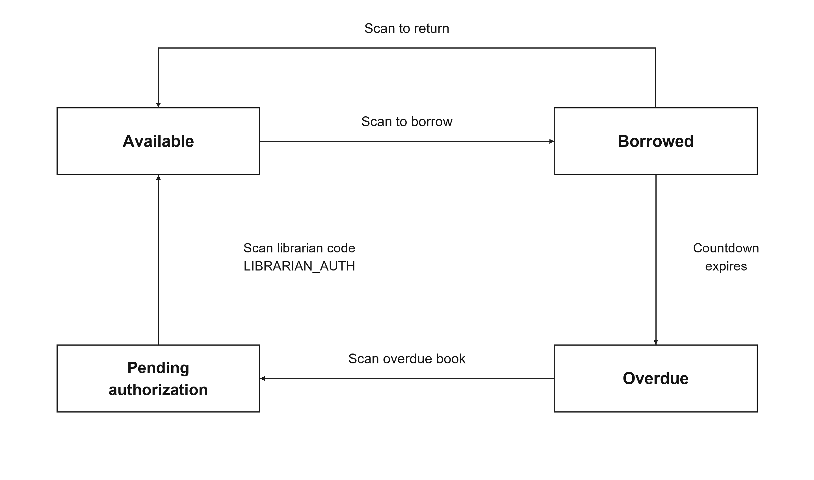
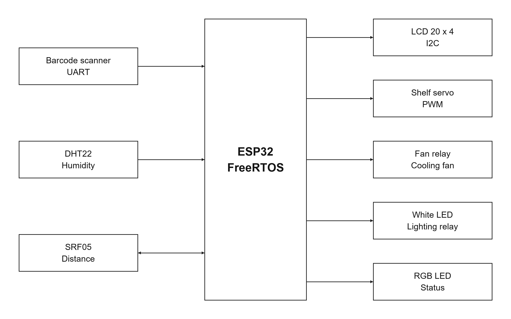

# Smart Library Management System

Hệ thống quản lý thư viện thông minh sử dụng **ESP32 và FreeRTOS**, kết hợp quét mã vạch để quản lý mượn/trả sách, theo dõi thời gian mượn, kiểm soát cửa kệ và giám sát độ ẩm môi trường.

Dự án thuộc hướng thiết kế hệ thống nhúng và đồng thiết kế phần cứng–phần mềm (HW/SW Co-Design). Mục tiêu là giảm thao tác thủ công, cập nhật trạng thái sách và phối hợp nhiều chức năng bằng các tác vụ chạy đồng thời.

README được tổng hợp từ [báo cáo thiết kế kỹ thuật](word%20rtos.docx) và đối chiếu với [mã nguồn phiên bản v5](smart_library_v5.ino).

## Chức năng chính

- **Mượn và trả sách bằng mã vạch:** nhận dữ liệu từ máy quét UART, tìm sách và cập nhật trạng thái.
- **Theo dõi quá hạn:** đếm thời gian mượn, phát cảnh báo trên Serial và bật cờ hạn chế mở kệ khi có sách quá hạn.
- **Xác nhận trả sách quá hạn:** yêu cầu quét mã thủ thư trước khi đưa sách về trạng thái sẵn sàng.
- **Điều khiển cửa kệ và đèn:** cảm biến siêu âm phát hiện người đến gần; servo mở kệ khi không bị hạn chế.
- **Giám sát độ ẩm:** đọc DHT22, bật quạt qua relay khi độ ẩm vượt ngưỡng.
- **Hiển thị trạng thái:** LCD 20×4 hiển thị khoảng cách, độ ẩm và trạng thái hai sách; LED RGB báo tình trạng mượn/quá hạn.

## Luồng hoạt động

1. Khi cấp nguồn, ESP32 khởi tạo cảm biến, LCD, servo, bộ định thời và các tác vụ FreeRTOS. Cửa kệ ở trạng thái đóng.
2. Khi người dùng đến gần dưới ngưỡng khoảng cách và không có cờ hạn chế, servo mở cửa kệ và đèn trắng bật.
3. Người dùng quét mã sách:
   - Sách sẵn sàng → chuyển sang đang mượn và bắt đầu đếm thời gian.
   - Sách đang mượn → chuyển về sẵn sàng khi quét lại.
   - Sách quá hạn → chuyển sang chờ xác nhận thủ thư.
4. Khi hết thời gian mượn, hệ thống đánh dấu quá hạn, báo trên Serial và giữ cửa kệ đóng.
5. Thủ thư quét mã xác nhận để hoàn tất trả sách quá hạn. Hạn chế được gỡ khi không còn sách quá hạn hoặc chờ xác nhận.
6. Song song với thao tác sách, hệ thống tiếp tục đo độ ẩm, điều khiển quạt và cập nhật LCD.

## Phần cứng

| Thành phần | Vai trò |
| --- | --- |
| ESP32 Development Board | Bộ điều khiển trung tâm chạy FreeRTOS |
| DHT22 | Đo độ ẩm môi trường trong firmware v5 |
| SRF05 | Đo khoảng cách để phát hiện người đến gần kệ |
| LCD 2004A, I2C, 20×4 | Hiển thị dữ liệu cảm biến và trạng thái sách |
| MH-ET LIVE Barcode Scanner V3.0 | Đọc mã vạch sách và gửi chuỗi ASCII qua UART |
| Micro Servo 9g, SG90 | Đóng/mở cửa kệ |
| Relay và quạt 5 V | Điều khiển quạt theo độ ẩm |
| Đèn trắng và LED RGB | Chiếu sáng kệ và báo trạng thái |
| LM2596 DC–DC Buck Converter | Hạ và ổn định nguồn cho các module |
| Dây nối | Kết nối các thành phần |

Danh mục linh kiện và dự toán nằm trong phần **Bill of Material** của báo cáo Word. Cần kiểm tra nguồn cấp, mức tín hiệu và cấu hình kích relay theo phần cứng thực tế trước khi chạy.

### Chân kết nối trong mã nguồn

| Thiết bị / tín hiệu | GPIO ESP32 |
| --- | --- |
| DHT22 DATA | 4 |
| SRF05 TRIG / ECHO | 18 / 19 |
| Servo | 25 |
| Relay quạt | 26 |
| Relay đèn | 27 |
| Đèn trắng | 33 |
| LED RGB R / G / B | 13 / 12 / 14 |
| UART máy quét RX / TX trên ESP32 | 16 / 17 |

LCD được cấu hình địa chỉ I2C **0x27**, kích thước **20×4**. Mã nguồn dùng bus I2C mặc định; chân SDA/SCL cần đối chiếu với board ESP32 được chọn.

## Kiến trúc FreeRTOS

| Tác vụ | Chức năng | Chu kỳ / cơ chế |
| --- | --- | --- |
| `TaskBarcode` | Nhận mã vạch, xử lý mượn/trả và xác nhận thủ thư | Kiểm tra UART; nghỉ 50 ms giữa các vòng xử lý |
| `TaskBookTimer` | Cập nhật thời gian mượn, phát hiện quá hạn và điều phối hạn chế kệ | 500 ms |
| `TaskDHT` | Đọc độ ẩm, điều khiển relay quạt | 2 giây |
| `TaskShelfControl` | Đọc khoảng cách, điều khiển servo và đèn | Nghỉ 100 ms sau mỗi vòng |
| `TaskLCD` | Tổng hợp trạng thái và cập nhật màn hình | Theo sự kiện hoặc timeout 2 giây |
| `TaskRGB` | Báo trạng thái tổng thể bằng LED RGB | 200 ms |

Các tác vụ phối hợp qua:

- **Mutex `bookMutex`:** bảo vệ dữ liệu sách dùng chung.
- **Event Group `xSysEvents`:** truyền cờ hạn chế kệ (`RESTRICT_BIT`) và yêu cầu cập nhật LCD (`LCD_UPDATE_BIT`).
- **Bộ định thời `esp_timer`:** tạo nhịp một giây. Callback tích lũy số tick; `TaskBookTimer` dùng số tick đó để cập nhật thời gian còn lại.

## Cấu hình phiên bản v5

| Tham số | Giá trị mặc định |
| --- | --- |
| Số sách mẫu | 2 |
| Thời gian mượn mô phỏng | 15 giây |
| Ngưỡng mở kệ | Khoảng cách hợp lệ nhỏ hơn 80 cm và không bị hạn chế |
| Ngưỡng bật quạt | Độ ẩm lớn hơn 80% |
| Góc servo đóng / mở | 0° / 80° |
| Serial debug | 115200 baud |
| UART máy quét | 9600 baud, 8N1 |
| Mã xác nhận thủ thư | `LIBRARIAN_AUTH` |

### Dữ liệu sách mẫu

| Mã vạch | Tên trong firmware |
| --- | --- |
| `9786043920932` | TTBT,KDBP |
| `9786043943719` | Chi Pheo |

### Trạng thái trên LCD

| Ký hiệu | Ý nghĩa |
| --- | --- |
| `AVA` | Sách sẵn sàng |
| `Txx` | Sách đang mượn, còn xx giây |
| `OVER` | Sách quá hạn |
| `AUTH?` | Đang chờ xác nhận thủ thư |

LED RGB hiển thị **đỏ** khi có sách quá hạn hoặc chờ xác nhận, **xanh lá** khi có sách đang mượn và không có quá hạn, **xanh dương** khi tất cả sách sẵn sàng.

## Cài đặt và nạp chương trình

1. Cài Arduino IDE và gói board **ESP32 by Espressif Systems**.
2. Cài các thư viện cần thiết qua Library Manager:
   - `LiquidCrystal_I2C`
   - `DHT sensor library` của Adafruit và thư viện phụ thuộc theo yêu cầu
   - `ESP32Servo`
3. Tải repository về máy. Đặt file `smart_library_v5.ino` trong thư mục tên `smart_library_v5`, sau đó mở bằng Arduino IDE.
4. Chọn đúng board ESP32 và cổng kết nối.
5. Đấu nối phần cứng theo cấu hình GPIO, kiểm tra nguồn cấp, địa chỉ LCD và mức kích relay.
6. Biên dịch và nạp chương trình. Mở Serial Monitor ở **115200 baud** để xem cảnh báo.

FreeRTOS và `esp_timer` được cung cấp cùng nền tảng Arduino ESP32. Repository hiện chưa khóa phiên bản board/thư viện và chưa có cấu hình build tự động.

## Hướng dẫn sử dụng

1. Cấp nguồn và quan sát LCD hiển thị trạng thái ban đầu.
2. Đến gần cảm biến siêu âm để kiểm tra mở kệ và đèn khi hệ thống không bị hạn chế.
3. Quét một mã sách mẫu để mượn. LCD hiển thị thời gian còn lại.
4. Quét lại trước khi hết thời gian để trả sách.
5. Để thử quá hạn, chờ hết 15 giây. LCD hiển thị `OVER`, LED RGB chuyển đỏ và cửa kệ bị hạn chế.
6. Quét lại mã sách quá hạn để chuyển sang `AUTH?`, sau đó quét `LIBRARIAN_AUTH` để xác nhận trả.
7. Theo dõi độ ẩm trên LCD; quạt được bật khi giá trị đọc lớn hơn 80%.

Máy quét cần gửi mã dạng chuỗi kết thúc bằng ký tự xuống dòng để phù hợp với cách đọc `Serial2.readStringUntil('\n')` trong chương trình.

## Phạm vi và lưu ý

Đây là mô hình học tập với dữ liệu hai sách lưu trong RAM. Trạng thái được khởi tạo lại khi reset hoặc mất nguồn. Firmware chưa có cơ sở dữ liệu bền vững, ứng dụng web/mobile, kết nối cloud hay quản lý tài khoản người dùng.

Báo cáo trình bày cả mục tiêu thiết kế và kết quả thử nghiệm của nhóm. Một số mô tả trong tài liệu rộng hơn triển khai v5:

- DHT22 hỗ trợ đo nhiệt độ, nhưng firmware hiện chỉ đọc độ ẩm.
- Tài liệu đề cập queue; mã v5 phối hợp chủ yếu bằng mutex, Event Group và bộ định thời.
- Cửa kệ trong v5 được điều khiển theo khoảng cách và cờ hạn chế chung; quét mã cập nhật trạng thái sách.
- Xác nhận thủ thư dùng một mã cố định và chỉ giữ một yêu cầu chờ xác nhận tại một thời điểm. Đây là cơ chế mô phỏng.
- Các chỉ tiêu độ trễ, uptime và kết quả phần cứng trong báo cáo chưa được xác minh lại cho bản mã trong repository.

## Thành viên thực hiện

| Thành viên | MSSV |
| --- | --- |
| Bùi Nguyễn Hưng | 23119009 |
| Nguyễn Đức Vĩnh Kiên | 23119014 |
| Nguyễn Văn Tấn | 23119035 |

**Ngành:** Computer Engineering Technology  
**Giảng viên hướng dẫn:** Assoc. Prof. Phan Van Ca

## Tài liệu trong repository

- [smart_library_v5.ino](smart_library_v5.ino): mã nguồn Arduino ESP32.
- [word rtos.docx](word%20rtos.docx): Technical Design Document, gồm yêu cầu, kiến trúc, thiết kế phần cứng, kết quả, phân công và hướng dẫn sử dụng.

Bản SVG của sơ đồ: [phần cứng](docs/images/smart-library-hardware.svg) · [trạng thái sách](docs/images/smart-library-book-states.svg).
